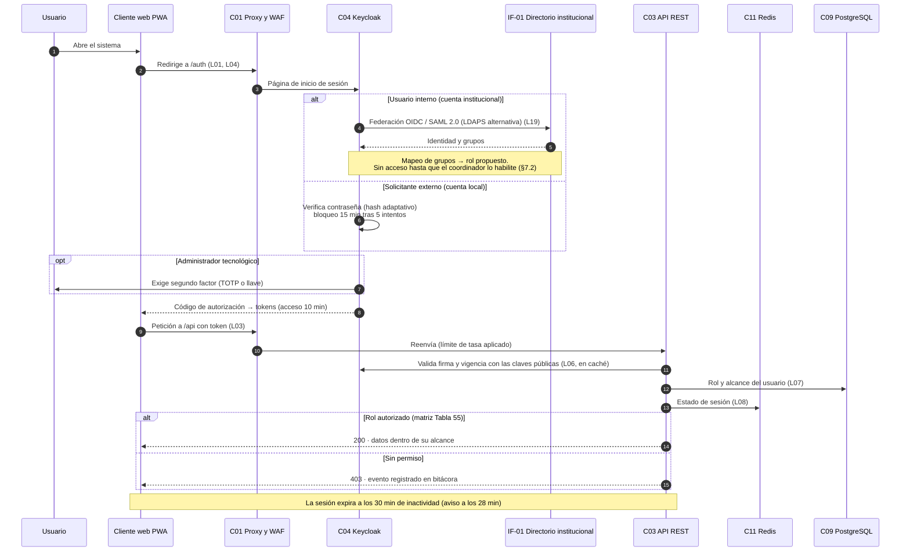
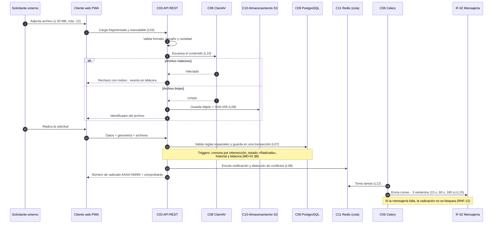
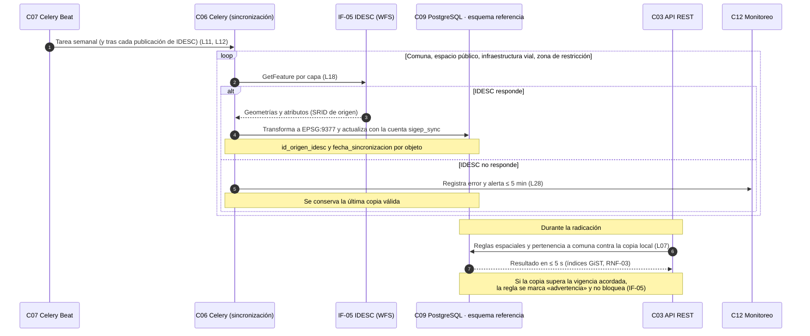

# Arquitectura de producción

> **Propuesta académica · v1.1 (2026-10-23).** Diseño propuesto, no infraestructura implementada.
> Despliegue en el **datacenter de DATIC** (decisión DE-13). Nombres de servidor y direcciones IP **simulados** en rangos
> reservados para documentación (RFC 5737). Documento completo: `ARQ-01_Arquitectura-Produccion_v1.1.pdf`.

Sistema SIG para la Gestión de Intervenciones en el Espacio Público de Santiago de Cali · Taller 3 · Universidad del Valle

## D1 · Zonas, componentes y flujos

```mermaid
---
config:
  layout: elk
  elk:
    mergeEdges: false
    nodePlacementStrategy: BRANDES_KOEPF
---
%% ARQ-01 · D1 · Arquitectura lógica de producción
%% Sistema SIG para la Gestión de Intervenciones en el Espacio Público de Cali
%% Propuesta académica v1.1 · La capa física en el datacenter de DATIC está en D5
flowchart LR
  subgraph Z0["Z0 · Usuarios — Internet y red interna"]
    direction TB
    U1["Solicitante externo<br/>navegador o móvil"]
    U2["Revisor y coordinador<br/>navegador (red interna)"]
    U3["Inspector de campo<br/>móvil · sin conexión"]
    PWA["Cliente web PWA<br/>React + TypeScript + OpenLayers<br/>portal · bandeja · panel · módulo de visitas<br/>caché local: borradores y cola de visitas"]
    EXT["Clientes SIG externos<br/>cuenta de servicio (SP-01)"]
  end

  subgraph Z1["Z1 · Perímetro (DMZ)"]
    WAF["C01 · Proxy inverso y WAF<br/>Nginx · TLS ≥ 1.2 · límites de tasa"]
  end

  subgraph Z2["Z2 · Aplicación (contenedores)"]
    direction TB
    WEB["C02 · Servidor web del cliente<br/>archivos estáticos de la PWA"]
    API["C03 · API REST — FastAPI<br/>monolito modular (8 módulos)<br/>+ adaptador IDESC (WMS)"]
    IDP["C04 · Proveedor de identidad<br/>Keycloak · OpenID Connect · 2FA"]
    GS["C05 · GeoServer + GeoWebCache<br/>WMS · WFS · OGC API – Features"]
    CEL["C06 · Tareas asíncronas — Celery<br/>adaptadores: mensajería, gestión documental<br/>sincronización IDESC"]
    BEAT["C07 · Programador de tareas<br/>Celery Beat"]
    AV["C08 · Análisis de archivos<br/>ClamAV"]
  end

  subgraph Z3["Z3 · Datos"]
    direction TB
    DB[("C09 · PostgreSQL + PostGIS<br/>principal → réplica<br/>catalogo · nucleo · referencia · auditoria")]
    S3[("C10 · Almacenamiento de objetos<br/>API S3 · cifrado · versionado")]
    RD[("C11 · Redis<br/>sesiones · colas · caché WMS")]
  end

  subgraph Z4["Z4 · Gestión y operación (acceso solo por VPN)"]
    direction TB
    MON["C12 · Monitoreo y registros<br/>Prometheus · Grafana · Loki<br/><i>L27: recibe métricas y registros<br/>de todos los componentes</i>"]
    BK[("C13 · Respaldo local<br/>copia 2 · diario")]
    BKX[("C14 · Respaldo externo<br/>copia 3 · otro sitio")]
    SEC["C15 · Gestor de secretos<br/>tecnología por definir<br/><i>L30: entrega credenciales<br/>a los componentes al iniciar</i>"]
    ADM["Administrador tecnológico<br/>VPN institucional + 2FA"]
  end

  subgraph Z5["Z5 · Servicios institucionales externos"]
    direction TB
    DIR["IF-01 · Directorio de usuarios"]
    MSG["IF-02 · Mensajería (correo)"]
    GD["IF-03 · Gestión documental"]
    IDE["IF-05 · IDESC<br/>WMS · WFS"]
  end

  U1 & U2 & U3 --- PWA
  PWA -->|"L01 HTTPS"| WAF
  EXT -->|"L01 HTTPS"| WAF
  WAF -->|"L02"| WEB
  WAF -->|"L03 /api"| API
  WAF -->|"L04 /auth"| IDP
  WAF -->|"L05 /ows"| GS

  API -->|"L06 tokens"| IDP
  API -->|"L07 SQL"| DB
  API -->|"L08"| RD
  API -->|"L09 S3"| S3
  API -->|"L10 escaneo"| AV
  API -.->|"L17 WMS"| IDE

  BEAT -->|"L11"| RD
  CEL <-->|"L12 cola"| RD
  CEL -->|"L13 SQL"| DB
  CEL -->|"L14 S3"| S3
  CEL -.->|"L15 SMTP/API"| MSG
  CEL -.->|"L16 REST"| GD
  CEL -.->|"L18 WFS → referencia"| IDE

  IDP -.->|"L19 federación"| DIR
  IDP -->|"L20 SQL (BD propia)"| DB
  IDP -.->|"L21 correo de verificación"| MSG
  GS -->|"L22 SQL solo lectura"| DB
  GS -->|"L23 tokens"| IDP

  DB -->|"L24 replicación"| DB
  DB & S3 -->|"L25 copia diaria"| BK
  BK -->|"L26"| BKX

  MON -.->|"L28 alertas ≤ 5 min"| MSG
  ADM -->|"L29 VPN"| MON

  classDef user fill:#E8EEF7,stroke:#1F3864,color:#1F3864
  classDef edge fill:#5B6B7F,stroke:#3B4757,color:#fff
  classDef app fill:#1F3864,stroke:#14264A,color:#fff
  classDef geo fill:#2E7D4F,stroke:#1F5A38,color:#fff
  classDef data fill:#0F2A4A,stroke:#081A30,color:#fff
  classDef ops fill:#7F5A1F,stroke:#5A3F14,color:#fff
  classDef ext fill:#F2F2F2,stroke:#888,color:#333,stroke-dasharray: 5 3
  classDef prop fill:#1F3864,stroke:#E0A800,stroke-width:3px,color:#fff
  class U1,U2,U3,PWA,EXT user
  class WAF edge
  class WEB,API,IDP,CEL,AV app
  class BEAT prop
  class GS geo
  class DB,S3,RD data
  class MON,BK,BKX,ADM ops
  class SEC ops
  class DIR,MSG,GD,IDE ext
```

| ID | Componente | Tecnología | Zona |
|---|---|---|---|
| C00 | Cliente web PWA | React + TypeScript + OpenLayers | Z0 |
| C01 | Proxy inverso y WAF | Nginx + WAF | Z1 |
| C02 | Servidor web del cliente | Nginx (estáticos) | Z2 |
| C03 | API REST | Python + FastAPI (monolito modular) | Z2 |
| C04 | Proveedor de identidad | Keycloak (OpenID Connect) | Z2 |
| C05 | Servidor de mapas | GeoServer + GeoWebCache | Z2 |
| C06 | Tareas asíncronas | Celery | Z2 |
| C07 | Programador de tareas | Celery Beat | Z2 |
| C08 | Análisis de archivos | ClamAV | Z2 |
| C09 | Base de datos | PostgreSQL + PostGIS (principal y réplica) | Z3 |
| C10 | Almacenamiento de objetos | Compatible con S3 | Z3 |
| C11 | Redis | Redis | Z2 |
| C12 | Monitoreo y registros | Prometheus, Grafana, Loki | Z4 |
| C13 / C14 | Respaldo local / externo | Por definir | Z4 |
| C15 | Gestor de secretos | Por definir | Z4 |

Los flujos L01 a L33 (origen, destino, protocolo, puerto propuesto y referencia al Taller 2) están en la sección 7 de ARQ-01.

## D2 · Autenticación y autorización

## D3 · Carga de archivos y radicación

## D4 · Sincronización con IDESC

## D5 · Capa física en el datacenter de DATIC (simulación)

```mermaid
---
config:
  layout: elk
  elk:
    mergeEdges: false
    nodePlacementStrategy: BRANDES_KOEPF
---
%% ARQ-01 v1.1 · D5 · Capa física en el datacenter de DATIC (Alternativa B, DE-13)
%% SIMULACIÓN ACADÉMICA: direcciones en rangos reservados para documentación (RFC 5737). No son direcciones reales.
flowchart LR
  USR["Usuarios<br/>Internet · red interna"]
  ADM["Administrador tecnológico<br/>VPN institucional + 2FA"]

  subgraph DMZ["Z1 · Perímetro DATIC · 203.0.113.0/24"]
    direction TB
    VIP(["Dirección pública del sistema<br/>203.0.113.10 :443<br/>subdominio solicitado a DATIC"])
    LB1["sigep-lb01 · 203.0.113.11<br/>Nginx + WAF · 2 vCPU · 4 GB · 40 GB"]
    LB2["sigep-lb02 · 203.0.113.12<br/>Nginx + WAF · 2 vCPU · 4 GB · 40 GB"]
  end

  subgraph APP["Z2 · Aplicación · 198.51.100.0/26 · clúster K3s"]
    direction TB
    A1["sigep-app01 · 198.51.100.11<br/>8 vCPU · 16 GB · 100 GB SSD<br/>web · Keycloak · API ×2 · GeoServer · Redis"]
    A2["sigep-app02 · 198.51.100.12<br/>8 vCPU · 16 GB · 100 GB SSD<br/>web · Celery · API ×2 · GeoServer · Redis"]
    A3["sigep-app03 · 198.51.100.13<br/>8 vCPU · 16 GB · 100 GB SSD<br/>Keycloak · Celery · API ×2 · ClamAV · Beat"]
  end

  subgraph DAT["Z3 · Datos · 198.51.100.64/26"]
    direction TB
    DB1[("sigep-db01 · 198.51.100.71<br/>PostgreSQL + PostGIS principal<br/>4 vCPU · 16 GB · 100 GB SSD")]
    DB2[("sigep-db02 · 198.51.100.72<br/>réplica · 4 vCPU · 16 GB · 100 GB SSD")]
    OBJ[("sigep-obj01 a 04 · 198.51.100.81 a .84<br/>almacenamiento compatible con S3<br/>4 nodos")]
  end

  subgraph GES["Z4 · Gestión · 198.51.100.128/26"]
    direction TB
    MON["sigep-mon01 · 198.51.100.141<br/>Prometheus · Grafana · Loki<br/>4 vCPU · 8 GB · 200 GB"]
    BK1[("sigep-bkp01 · 198.51.100.151<br/>respaldo local")]
  end

  subgraph EXT["Sitio externo · 198.51.100.192/26"]
    BK2[("sigep-bkx01 · 198.51.100.201<br/>respaldo externo")]
  end

  subgraph INS["Z5 · Servicios institucionales (direcciones por confirmar)"]
    direction TB
    DIR["IF-01 Directorio"]
    MSG["IF-02 Correo"]
    GD["IF-03 Gestión documental"]
    IDE["IF-05 IDESC"]
  end

  USR -->|"HTTPS 443"| VIP
  VIP --- LB1 & LB2
  LB1 -->|"HTTP 80 · red privada · ingreso del clúster"| A2
  LB1 --> A1 & A3
  LB2 --> A1 & A2 & A3
  A1 -->|"5432"| DB1
  A2 & A3 --> DB1
  DB1 -->|"replicación 5432"| DB2
  A2 -->|"API S3 9000"| OBJ
  A1 & A3 --> OBJ
  A3 -.->|"HTTPS 443 · LDAPS 636 · SMTP 587"| INS
  A1 & A2 -.-> INS
  DB1 & OBJ -->|"copia diaria"| BK1
  BK1 -->|"copia externa"| BK2
  MON -.->|"métricas 9100 · registros 3100"| APP
  ADM -->|"VPN · SSH 22 · HTTPS 443"| MON

  classDef edge fill:#5B6B7F,stroke:#3B4757,color:#fff
  classDef app fill:#1F3864,stroke:#14264A,color:#fff
  classDef data fill:#0F2A4A,stroke:#081A30,color:#fff
  classDef ops fill:#7F5A1F,stroke:#5A3F14,color:#fff
  classDef ext fill:#F2F2F2,stroke:#888,color:#333,stroke-dasharray: 5 3
  classDef user fill:#E8EEF7,stroke:#1F3864,color:#1F3864
  class VIP,LB1,LB2 edge
  class A1,A2,A3 app
  class DB1,DB2,OBJ data
  class MON,BK1,BK2 ops
  class DIR,MSG,GD,IDE ext
  class USR,ADM user
```

## Archivos

| Archivo | Contenido |
|---|---|
| `ARQ-01_Arquitectura-Produccion_v1.1.pdf` | Documento completo (exigido por la guía 4.2: carpeta Arquitectura) |
| `diagramas/*.mmd` | Fuente Mermaid de cada diagrama (editable) |
| `diagramas/*.svg`, `*.pdf`, `*.png` | Exportaciones |
